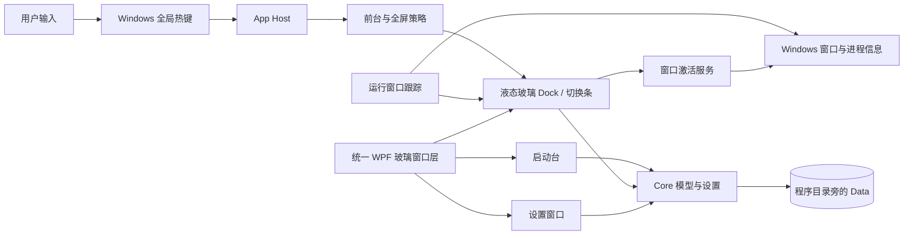
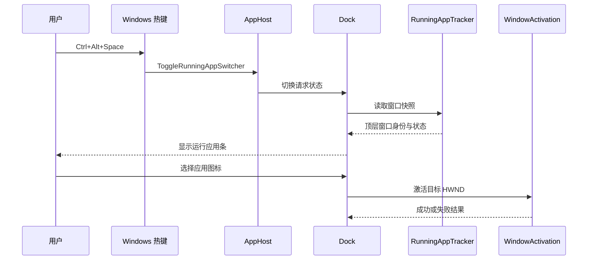

# LG Dsk

**面向 Windows 11 的液态玻璃 Dock 与启动台定制版：保留原有视觉，减少应用前台时 Dock 误弹，并在自动隐藏任务栏时提供常驻应用岛，查看和切换多窗口任务。**


         

> **玻璃留下，干扰退后，切换随手。**

LG Dsk 是公开维护的单用户 Windows 桌面程序，不是系统任务栏替代品、Web 服务或企业桌面管理平台。Stars、下载量与贡献者数量由徽章实时读取；项目不承诺 Issue 响应 SLA。Docker 拉取量、覆盖率和 CI 状态没有对应的项目数据，不使用虚构数值。

## 一、项目头部 Header

| 指标 | 当前状态 |
| --- | --- |
| 发布版本 | LG Dsk 1.4.4（断点续传、自动隐藏任务栏应用岛、暖色回退与 Dock 重定位） |
| 目标平台 | Windows 11 x64，Build 22000 及以上 |
| 主要技术 | C#、WPF、.NET 10、Windows API |
| 许可证 | Apache License 2.0；第三方资源遵循各自许可 |
| CI/CD | 未配置自动化流水线；本地 Release 构建已通过 |
| 测试覆盖率 | 未测量；不发布覆盖率徽章或百分比 |
| 安全扫描 | 未运行独立依赖漏洞或静态安全扫描 |
| Docker / Kubernetes | 不适用于本地 Windows 桌面程序 |
| Stars、下载量、贡献者 | 由 GitHub 徽章动态读取；随仓库活动变化 |
| Issue 响应 SLA | 未承诺；由单人维护者按能力处理 |

## 二、项目概览 Overview

### 当前版本说明

1.4.4 的逐项改动与验证边界见[版本说明](docs/RELEASE-NOTES-LG-Dsk-1.4.4.md)。每个发布版本都会附独立的变更说明和安装资产校验和。

### 背景与痛点 Background & Pain Points

项目来自一个具体的 Windows 桌面使用问题，而不是对整个 Dock 软件市场的量化研究：

1. **前台显示冲突：**使用普通应用时，鼠标碰到底边会把 Dock 唤出，遮挡应用并造成误触。目标行为是“桌面显示、应用前台收起”，而不是让 Dock 作为始终置顶窗口运行。
2. **多应用任务的可见性：**Windows 任务栏自动隐藏时，用户可能无法方便地查看已打开的窗口或知道应用是否仍在后台运行。LG Dsk 在其他应用位于前台时显示紧凑的玻璃应用岛；鼠标移入即可展开，查看 Dock 固定项、可切换窗口、应用库中识别到的后台进程，以及 Windows UI Automation 可访问的托盘项。全局快捷键仍可单独呼出切换条。
3. **改造边界：**重写整套桌面壳层会扩大窗口管理、数据迁移和兼容风险。项目选择保留 GlassDesk 的主要窗口与设置结构，只改品牌、前台显示策略和应用切换路径。

目前没有代表性用户样本、行业调查或对照实验，因此不把上述场景外推为行业规模，也不声称提升了特定百分比的效率或降低了特定比例的故障率。

### 项目定位 Project Positioning

LG Dsk 属于**单机桌面效率工具**，由 Dock、启动台、设置窗口和系统托盘构成。适用场景是 Windows 11 x64 上的个人应用入口与窗口切换。

它不负责隐藏、移动或重启 Windows 任务栏，不提供远程桌面管理、账号体系、网络服务、容器化部署、插件市场或公共 SDK。快捷应用条是补充操作路径，不是 Windows Alt+Tab 的完整替代品。

### 核心价值 Core Value Proposition

| 目标 | 可核验指标 | 当前证据 |
| --- | --- | --- |
| 减少普通应用前台时的边缘误唤出 | 前台应用策略不以鼠标边缘作为显示条件 | `DockPresentationPolicy` 与策略测试 |
| 自动隐藏任务栏时查看应用 | 其他程序位于前台时显示顶端应用岛；悬停展开并切换窗口或启动固定应用 | 呈现策略、应用清单与任务栏区域计算测试；目标设备实机仍待验收 |
| 提供快捷应用切换入口 | 默认 `Ctrl+Alt+Space`；也可点击自动出现的应用岛 | 设置默认值与快捷键测试 |
| 保留原启动台建组交互 | 约 500 ms 悬停 | 启动台实现与已有行为说明 |
| 避免高刷新率空转轮询 | 活跃动画 16 ms；静止轮询 100 ms | 源码调度值；不是 GPU/CPU 基准结果 |
| 交付自包含安装包 | 以 [最新 Release](https://github.com/LYL-Z/LG-Dsk/releases/latest) 与 SHA-256 清单为准 | 上传资产大小与校验和可在 Release 核验 |

上表中的调度间隔、文件大小和测试计数是可测事实，不代表对照版本的性能提升。当前没有实测启动延迟、CPU、GPU、显存或功耗数据。

### 可视化展示

图标预览展示的是实际随程序使用的 LG 标记。下图描述模块关系；本仓库没有可公开的真实应用窗口截图或目标笔记本性能曲线，因此不以示意图冒充运行截图。



## 三、设计哲学与原则 Design Philosophy

### 核心理念

优先保留用户已认可的液态玻璃视觉和 GlassDesk 的成熟交互，再以最小策略变化处理误弹和切换问题。Windows 桌面集成不可完全跨平台抽象，因此把 Win32 与 DWM 接口限制在平台层，并为能力缺失保留回退路径。

### 设计准则

1. **最小侵入：**不重写 Dock、启动台或设置窗口；在现有 Dock 表面增加切换模式。
2. **上下文优先：**桌面、普通应用前台、全屏和启动台使用不同呈现状态，避免一个全局“置顶”开关覆盖所有场景。
3. **显式/悬停展开：**自动隐藏任务栏时，完整运行应用条由已注册快捷键呼出，或鼠标移入顶端紧凑应用岛后展开；Dock 边缘触发不用于唤出应用条。
4. **轻量可发现：**其他应用位于前台且 Windows 任务栏自动隐藏时，应用岛固定在屏幕上方中央；鼠标移入显示固定应用、窗口、后台和可访问托盘项目。独占全屏程序仍可能覆盖普通桌面浮层。
5. **可测试的决策：**窗口策略与纯状态决策拆分，核心分支可由单元测试验证。
6. **本地数据边界：**应用库、布局、设置和图标数据保留在程序自己的 `Data` 目录；发布包不包含个人数据。
7. **兼容优先：**保留旧安装身份与内部托管程序集；发布文件使用 `LGDsk.exe`，升级时校验用户数据并迁移精确匹配的自启动路径。
8. **证据驱动：**未公开的上游实现、未测量的性能收益和未经真机验证的兼容范围都明确标注。

### 技术选型与取舍

| 选型 | 用途 | 取舍 |
| --- | --- | --- |
| C# / .NET 10 / WPF | Windows 桌面窗口、数据绑定和应用宿主 | 原生适配现有 WPF 项目；限定 Windows 平台 |
| Win32 / DWM / 少量 COM | 前台窗口、窗口枚举、热键、玻璃材质与桌面集成 | 可接近系统能力；部分 DWM 能力未公开，需能力探测和降级 |
| 分层类库 | Core、平台、应用服务、UI、Dock、启动台、设置 | 纯策略与数据逻辑较易测试；多项目结构增加构建边界管理成本 |
| 自包含 x64 发布 | 让用户不必预装 .NET Runtime | 降低运行时前置要求，但安装包更大 |
| Inno Setup 7 | 单文件用户级安装程序 | 易分发并支持选择目录；当前未进行真实安装/卸载验收，也未签名 |

## 四、核心架构设计 Core Architecture

### 分层与职责边界

| 层 | 关键工程 | 职责与边界 |
| --- | --- | --- |
| 桌面宿主 | `GlassDesk.App` | 单实例、托盘、窗口生命周期、全局交互与依赖组装；唯一发布的 EXE |
| 展示层 | `GlassDesk.UI` | WPF 玻璃窗口基类、主题、调色板和着色器；统一 Dock、启动台、设置的表面样式 |
| 功能层 | `GlassDesk.Dock`、`GlassDesk.Launcher`、`GlassDesk.Settings` | Dock 状态、应用条目、启动台交互与设置界面 |
| 应用服务层 | `GlassDesk.AppServices` | 应用导入、图标缓存、运行窗口跟踪与激活服务；不依赖 WPF |
| 平台层 | `GlassDesk.Platform` | Win32 窗口、显示器、DPI、托盘、全屏检测和系统集成 |
| 领域与存储层 | `GlassDesk.Core` | 设置、应用库、布局模型、文件存储和纯策略；不依赖 WPF/Win32 |
| 操作系统 | Windows 11 | 前台窗口、进程、DWM、热键和显示器状态的权威来源 |

### 核心数据流 Data Flow

#### Dock 显示策略

1. Dock 帧更新读取当前前台 HWND。
2. 平台层检查窗口是否可见、是否最小化、是否属于本进程或 Windows 桌面/任务栏，必要时检查 DWM cloak 状态。
3. 策略层结合启动台、普通外部前台窗口、全屏状态和切换条请求，解析成 `DesktopDock`、`RunningAppSwitcher` 或 `Hidden`。
4. 只有桌面上下文显示普通 Dock；其他应用位于前台时隐藏普通 Dock。任务栏自动隐藏时，应用岛显示在屏幕上方中央；鼠标移入或使用快捷键显示完整运行应用条。

核心判定可简化表示为：

```csharp
if (launcherActive || !externalApplicationForeground)
    return DockPresentationMode.DesktopDock;

if (switcherRequested)
    return DockPresentationMode.RunningAppSwitcher;

if (appIslandRequested) // Host confirms external fullscreen + Windows taskbar auto-hide.
    return DockPresentationMode.RunningAppIsland;

return DockPresentationMode.Hidden;
```

真实实现见 [`DockPresentationPolicy.cs`](src/GlassDesk.Dock/DockPresentationPolicy.cs)。该代码片段只说明策略输入输出，不代表 Windows 前台检测本身是纯函数。

#### 运行应用切换

1. `RegisterHotKey` 封装注册默认 `Ctrl+Alt+Space`。
2. `AppHost` 将热键动作交给 Dock。
3. Dock 读取跟踪器最近一次顶层窗口快照，排除自身进程和无效句柄。
4. 按有效 AppUserModelID、进程映像路径或 PID 归并同一应用的窗口；优先选择未最小化窗口。
5. 读取图标并显示在既有玻璃窗口上。用户点选后调用窗口激活服务；若 HWND 已失效或系统拒绝激活，则显示失败提示。



应用岛会显示 Dock 固定应用、可切换窗口、已匹配的后台进程和可访问的托盘图标。固定应用可直接打开或切换；展开列表可切换可见或最小化窗口；无顶层窗口的后台进程与托盘标签只作状态信息，不承诺可直接激活。后台匹配依赖应用库中可解析的程序路径；托盘项目依赖 Windows UI Automation 树，未暴露给辅助功能的图标可能缺失。全局快捷键也可从外部前台直接打开完整列表。独占全屏程序可能覆盖普通桌面浮层，此时 Windows `Alt+Tab` 仍是系统级回退路径。项目没有远程服务，因此没有分布式熔断、重试或一致性协议。

### 核心模块

- **`DockPresentationPolicy`：**纯策略输入输出，负责决定 Dock 当前模式。
- **`ForegroundCoverage`：**封装前台窗口进程、可见性、最小化、桌面类名及 DWM cloak 检查。
- **`WindowLocator` / `RunningAppTracker`：**枚举和跟踪顶层窗口，并解析路径与 AppUserModelID。
- **`RunningWindowSwitcherItems`：**排除自身窗口、按身份分组、选择代表窗口并生成显示名称与提示信息。
- **`RunningBackgroundAppItems`：**将应用库中的程序路径与当前进程映像匹配，补充显示没有顶层窗口的后台进程；不把未识别的系统进程混入应用列表。
- **`InteractionSettingsService`：**集中注册、更新和释放全局热键，处理热键冲突。
- **`AppPaths` / `GlassDeskDataStore`：**将设置、应用库、Dock 布局、启动台布局、图标、备份与日志放入本程序数据目录。

## 五、核心技术原理 Core Technical Principles

### 改进点与原创性边界

本项目的技术价值是针对具体前台行为的集成和状态边界处理，不宣称发明新的窗口管理算法、玻璃渲染技术或全局应用切换机制。更改集中在 `DockPresentationPolicy`、运行窗口项构造、快捷键路由和品牌资源；完整来源边界见[移植记录](docs/LG-Dsk-1.4.0.md)。

### 前台状态策略

状态转换将“外部普通窗口前台”与“桌面”区分开。公式化表示为：

\[
M = \begin{cases}
\text{DesktopDock}, & L \lor \neg E \\
\text{RunningAppSwitcher}, & E \land R \land \neg F \land A \\
\text{Hidden}, & \text{otherwise}
\end{cases}
\]

其中 `L` 为启动台活动、`E` 为普通外部窗口前台、`R` 为显式切换请求、`F` 为全屏、`A` 为有可切换应用。这里的 `M` 是呈现模式，不是窗口 Z-order 的替代策略。

### 运行窗口身份归并

身份优先级为：有效 AppUserModelID → 进程映像完整路径 → PID。按完整路径而非进程名归并，减少同名不同安装位置被合并的风险。选择顺序依赖 Windows 顶层窗口枚举顺序，优先选取非最小化候选；这并不保证所有应用的多窗口语义完全一致。

### 性能策略与边界

- Dock 动画帧调度约为 16 ms，静止轮询约为 100 ms。间隔是实现参数，不是平均帧率、耗电或 GPU 时间测量。
- 全屏睡眠由性能协调器观察前台状态并施加延迟，减少窗口瞬态变化造成的状态抖动。具体行为按现有服务逻辑运行。
- 本版没有针对 240 Hz 强行运行 240 次/秒的静止轮询，也没有据此声称降低了多少 CPU/GPU 占用。
- 自包含 ReadyToRun 发布缩短首次 JIT 的依赖路径，但没有此项目的冷启动对照数据；代价是更大的安装包。

### 高可用与一致性

LG Dsk 是本地单实例程序，不存在多节点服务、共识协议或跨机器数据一致性问题。应用数据由本地文件持久化；项目包含备份/恢复能力，但不等于云备份或自动灾难恢复。卸载与降级前应自行保留备份。

## 六、安全设计 Security

### 威胁模型

| 资产/攻击面 | 主要风险 | 当前缓解与边界 |
| --- | --- | --- |
| `Data` 下的设置、应用条目和布局 | 文件损坏、错误恢复、意外覆盖 | 独立本地目录、备份服务；不加密，目录权限沿用当前 Windows 用户权限 |
| 用户导入的快捷方式、文件和图标 | 外部路径变化或不可信文件 | 导入行为由用户触发；项目不替代 Windows Defender 或文件来源审核 |
| HWND、进程路径和全局热键 | 窗口竞态、权限差异、热键冲突 | 通过 Windows API 查询；无效窗口会失败返回，不保证能激活所有高权限窗口 |
| 安装程序 | 供应链冒充、下载损坏 | 发布 SHA-256 可检查文件是否与清单一致；当前无 Authenticode 签名，哈希不证明发布者身份 |
| 在线更新源 | 非预期发布冒充、错误安装包或损坏下载 | 更新接口限定为本项目 HTTPS GitHub Releases；按资产名、状态、大小和 GitHub SHA-256 校验；更新安装包启动前再次校验 |

应用采用用户级安装（`PrivilegesRequired=lowest`），不安装驱动或系统服务。当前没有对外监听端口、公开 API 或账号认证层。关闭自动更新不代表已经完成完整网络行为审计。

### 安全审计与合规

截至本版本，没有独立渗透测试、SBOM 发布、依赖漏洞扫描、代码覆盖率报告、GDPR/等保/SOC 2 认证或企业合规评估。请勿把本工具用于要求经过这些认证的终端管理场景。项目不采集或发送遥测的结论尚未经过独立网络流量审计，因此此处不作绝对承诺。

### 漏洞披露

尚未建立专门的安全响应邮箱、分级流程或处理时限。敏感问题不应通过公开 Issue 暴露利用细节；请使用仓库支持的私密方式联系维护者。收到报告后的处理时间目前没有 SLA。

## 七、关键特性 Key Features

| 模块/特性 | 功能与实现要点 | 适用场景 |
| --- | --- | --- |
| 基础：液态玻璃 Dock | 共用现有 WPF 玻璃窗口与主题层，不重写主界面 | 希望保留 GlassDesk 原有视觉和设置习惯 |
| 基础：启动台 | 延续应用分页、布局与悬停建文件夹；约 500 ms 达到建组条件 | 从启动台整理和打开桌面应用 |
| 高级：前台收起 | 前台/全屏状态经过策略解析，边缘移动不再独自唤出普通 Dock | 正在使用普通应用或游戏时避免 Dock 覆盖 |
| 高级：自动隐藏任务栏应用岛 | 任务栏自动隐藏且外部程序位于前台时出现；悬停展开应用清单 | 在全屏、最大化或普通窗口工作时均可查看应用入口 |
| 高级：应用切换条 | 全局快捷键或点击应用岛、窗口快照、身份归并、图标显示和 HWND 激活 | 在多个窗口间切换；后台无窗口进程会显示状态但不能直接激活 |
| 安装：自包含发布 | x64 ReadyToRun 包与 Inno Setup 安装程序；不要求单独安装 .NET Runtime | 普通 Windows 11 x64 桌面部署 |
| 企业级能力 | 没有集中管理、RBAC、集群、远程策略或企业 SLA | 不适用于集中式终端管理要求 |
| 维护能力 | 设置中手动/每日自动检查 GitHub 正式版；下载和安装均需用户确认，安装器启动前校验资产 | 让用户检查并升级到公开正式版本；便携版仍需手动安装 |
| 生态扩展 | 当前没有公共插件 API 或 SDK | 作为本地桌面工具独立使用 |

策略的最小代码示例：

```csharp
var mode = DockPresentationPolicy.Resolve(
    launcherActive,
    externalApplicationForeground,
    foregroundIsFullscreen,
    hasSwitchableApplications,
    switcherRequested);
```

应用切换不提供外部 API。默认热键可在快捷操作设置中查看或调整；若该组合已被其他程序占用，注册可能失败，需选择未冲突的快捷键。

## 八、技术栈全景 Tech Stack

| 分层 | 技术与版本边界 | 采用原因 |
| --- | --- | --- |
| 语言 | C#，`LangVersion=latest`；目标 .NET 10 | 与现有 GlassDesk 桌面代码保持一致 |
| UI | WPF，`net10.0-windows10.0.26100.0` | 原生窗口、控件与桌面生命周期 |
| 领域逻辑 | `net10.0` 类库 | Core 不依赖 WPF/Win32，可单独单元测试 |
| Windows 集成 | User32、DWM、COM、Per-Monitor DPI | 获取前台、热键、窗口身份、玻璃与显示器信息 |
| 存储 | 本地 JSON/文件目录 | 单用户桌面数据不需要服务端数据库 |
| 发布 | `win-x64`、Self-contained、ReadyToRun | 减少目标机运行时前置条件 |
| 安装器 | Inno Setup 7.1.0（本次实际编译器） | 生成中文用户级单文件安装包 |
| 测试 | xUnit 测试项目与 Windows 桌面验收工程 | 分离纯逻辑测试和依赖交互桌面的验收 |
| CI/可观测性 | 未配置 GitHub Actions、OpenTelemetry 或集中日志 | 本项目是本地应用；当前没有服务端运营面 |

`global.json` 指定 .NET SDK 10.0.401，并允许同一功能带内滚动。源项目 SDK 目标为 Windows 10.0.26100.0，安装包运行兼容下限为 Windows 11 Build 22000；这些是不同概念。高级玻璃效果涉及部分未公开 DWM 能力，具体可用性按系统能力判断并降级。

## 九、性能基准测试 Benchmarks

### 环境与结果边界

用户提供的目标参考设备为联想拯救者 RTX 5090，显示模式截图为 3840 × 2400、240 Hz、10 位 SDR。当前没有在该设备上进行实际运行、长稳或 GPU 捕获测试，故不报告 P50/P95/P99、吞吐量、CPU、GPU、VRAM、磁盘 IO、功耗或帧时间百分位。

| 指标 | 当前结果 | 证据层级 |
| --- | --- | --- |
| 活跃动画调度 | 16 ms 配置间隔 | 源码参数；非实测帧率 |
| 静止检查间隔 | 100 ms 配置间隔 | 源码参数；非耗电数据 |
| Core 自动化测试 | 161/161 通过 | 本地 .NET 10 Release 测试 |
| AppServices 自动化测试 | 383/383 通过 | 含更新断点续传、中断重试与校验测试 |
| Dock 自动化测试 | 502/502 通过 | 含应用岛呈现、固定/后台/托盘项目和任务栏区域定位 |
| 完整 Release 构建 | 0 警告、0 错误 | 本地 .NET 10.0.401 |
| 安装器与便携 ZIP | 已编译并通过 `verify-package.ps1` | x64，自包含发布 |
| NuGet 漏洞扫描 | 未发现易受攻击依赖 | 当前配置的 NuGet 源 |

这些结果是本地自动化、Release 构建与安装包校验。详细记录见[1.4.4 版本说明](docs/RELEASE-NOTES-LG-Dsk-1.4.4.md)。真实交互安装、持续断网恢复、托盘图标覆盖率及 RTX 5090 实机验收仍需在目标 Windows 桌面完成。

### 横向/纵向对比

尚未对比其他 Dock、Windows 任务栏或上游 1.4.0 安装包的吞吐、资源占用、启动时间和持续性能。当前没有可用于横向/纵向图表的同条件数据，不提供虚构曲线或百分比。上游 1.4.0 私有源代码也未公开，不能据此做逐行实现性能比较。

### 复现方式

```powershell
dotnet test tests/GlassDesk.Core.Tests/GlassDesk.Core.Tests.csproj -c Release
dotnet test tests/GlassDesk.AppServices.Tests/GlassDesk.AppServices.Tests.csproj -c Release
dotnet test tests/GlassDesk.Dock.Tests/GlassDesk.Dock.Tests.csproj -c Release
```

这些命令复现自动化测试，不会生成硬件基准。真实体验验收需在 Windows 桌面上打开应用、移动鼠标到屏幕边缘、验证 `Ctrl+Alt+Space` 和全屏避让，并记录系统版本、显示器、GPU 驱动、CPU/GPU/显存与时间序列。

## 十、快速开始 Quick Start

### 环境与最短流程

1. 从[最新 Release](https://github.com/LYL-Z/LG-Dsk/releases/latest)下载 Windows x64 安装包。
2. 先从托盘完全退出仍在运行的 GlassDesk，再启动安装程序。
3. 新装默认位置为 `%LOCALAPPDATA%\Programs\LG Dsk`；从旧版升级时，安装器会校验并迁移旧 `Data`，再移除旧安装。若无法安全校验或目标目录已有用户数据，安装会停止而不会覆盖。
4. 如需桌面快捷方式，勾选安装选项。
5. 启动后回到桌面查看 Dock；打开普通应用后 Dock 应收起。
6. 按 `Ctrl+Alt+Space` 呼出运行应用条并点选一个窗口；若 Windows 任务栏设为自动隐藏，打开任意外部应用后应看到顶部紧凑应用岛，移入后可查看并切换窗口。

便携版用户可下载 ZIP、解压并运行 `LGDsk.exe`。首次运行会在程序旁生成独立的 `Data` 目录。

### 从源码启动

需要 Windows 11 x64 与 .NET SDK 10.0.401：

```powershell
dotnet build src/GlassDesk.App/GlassDesk.App.csproj -c Release
dotnet run --project src/GlassDesk.App/GlassDesk.App.csproj -c Release
```

运行开发版前退出同一用户会话中已运行的安装版，避免单实例协调让第二个进程直接退出。

## 十一、安装与部署 Installation & Deployment

### 安装形态

| 方式 | 支持状态 | 说明 |
| --- | --- | --- |
| Windows x64 Setup EXE | GitHub Release | Inno Setup 用户级安装，允许选择目录，可选桌面快捷方式；从[最新发布](https://github.com/LYL-Z/LG-Dsk/releases/latest)下载 |
| 自包含 ZIP | GitHub Release | 解压运行，数据留在解压目录旁；与安装器共享版本化说明和 SHA-256 清单 |
| 源码编译 | 支持 | 使用 .NET SDK 10.0.401；安装器构建另需 Inno Setup 7 |
| Windows 包管理器 | 未提供 | 没有 Winget/Chocolatey/Scoop 清单 |
| Docker / Kubernetes / Helm | 不适用 | WPF 交互桌面程序需要用户会话和 Windows Shell |

安装目录默认是 `%LOCALAPPDATA%\Programs\LG Dsk`。从 1.4.2 起，发布程序文件名为 `LGDsk.exe`；安装身份与内部程序集保持兼容，新安装不会再留下旧主程序 `GlassDesk.exe`。升级时仅在确认产品拥有旧文件后清除它，并把精确指向旧主程序的当前用户自启动项更新到新文件。检测到旧版 GlassDesk 安装时，安装器校验注册路径与卸载程序，逐文件复制并校验 `Data`，然后卸载旧程序。若校验失败、迁移目录含重解析点、目标已有数据或旧程序仍在运行，安装会停止。卸载阶段若中断，迁移暂存数据会保留；若旧卸载状态无法确认，后续安装会停止并要求人工检查，不会删除暂存副本。迁移脚本不主动删除旧目录的 `Data` 副本；旧卸载器若保留非空目录，可在确认新版本数据正常后手动清理。重要设置仍建议预先备份。

### 配置与数据

程序没有服务器端配置、环境变量或命令行管理 API。设置由 GUI 管理，程序数据放在 `AppContext.BaseDirectory\Data`，主要包括：

| 文件/目录 | 内容 |
| --- | --- |
| `settings.json` | 外观、快捷键与其他应用设置 |
| `apps.json` | 应用库与用户导入项 |
| `dock-layout.json` | Dock 布局 |
| `launcher-layout.json` | 启动台布局 |
| `icons/` | 图标缓存及用户导入图标 |
| `backup/` | 用户主动创建的备份 |
| `logs/` | 本地日志 |

JSON 结构属于应用内部持久化格式，不承诺是稳定的外部 API；优先通过设置界面和内置备份操作修改数据。

### 升级与回滚

同一安装目录覆盖升级会沿用现有 `Data`。降级前先从设置中备份数据；较新版本写入的数据结构不一定能被更老版本完整读取。当前没有独立迁移 CLI、灰度通道或自动回滚系统，恢复方式是重装目标安装包并在确认兼容后还原备份。

## 十二、使用指南 Usage Guide

### 基本操作

- **桌面 Dock：**桌面上下文显示；普通外部应用成为前台后收起。
- **运行应用切换：**默认 `Ctrl+Alt+Space` 可随时展开运行应用条；任务栏自动隐藏且任意外部应用位于前台时，顶端紧凑应用岛会出现，鼠标移入即可展开。点选窗口可激活其代表窗口，点选固定应用可启动或切换。
- **后台与托盘项目：**清单包含应用库匹配到的无窗口进程和 Windows UI Automation 可访问的通知区域项目。后台进程没有可激活窗口时只显示状态；未暴露给辅助功能树的托盘图标可能不会被列出。
- **启动台文件夹：**把应用拖到另一应用上悬停约 500 ms 创建文件夹；提前松开按普通排序处理。
- **全屏：**检测到全屏时抑制被动 Dock 弹出；如果 Windows 任务栏自动隐藏，应用岛在其他应用位于前台时显示轻量状态，鼠标移入或按快捷键展开应用条。部分独占全屏程序可能遮挡应用岛。
- **系统任务栏：**LG Dsk 不关闭、移动或接管系统任务栏。自动隐藏状态仍由 Windows 设置管理。

### API 与 SDK

当前没有面向第三方的公共 HTTP/IPC API、SDK 或插件接口。桌面集成由程序内部接口和 Windows API 实现；内部类不应视为稳定扩展合同。

## 十三、项目治理与社区 Community & Governance

仓库已公开，由个人维护。贡献流程、行为准则、安全披露与 Issue 模板见 [`CONTRIBUTING.md`](CONTRIBUTING.md)、[`CODE_OF_CONDUCT.md`](CODE_OF_CONDUCT.md)、[`SECURITY.md`](SECURITY.md) 和 [`.github/ISSUE_TEMPLATE`](.github/ISSUE_TEMPLATE)。目前没有维护者委员会、社区会议、贡献者晋升机制或支持 SLA；PR 由仓库维护者逐项审阅，不承诺固定响应时间。

源码改动应保留 Apache 2.0 及第三方 NOTICE，避免提交用户 `Data`、个人图标、桌面截图或日志；变更说明应区分本地测试、安装器编译和真实机器验收。

## 十四、路线图与规划 Roadmap

### 已完成里程碑

- 以公开 GlassDesk 1.3.1 源码为基础，保留原液态玻璃 Dock、启动台和设置结构。
- 重建选定公开 1.4.0 更新说明中的启动台悬停建组行为。
- 实现外部应用前台隐藏策略与显式运行应用切换条。
- 完成 LG 图标、产品元数据、安装脚本和自包含 x64 发布包。
- 1.4.1 将新安装目录统一为 LG Dsk，并为从旧目录升级增加用户数据校验迁移。
- 1.4.2 将发布主程序名改为 `LGDsk.exe`，设置页采用暖色 Claude 衍生配色，并修复设置窗遮挡/闪烁与透明宠物浮层的桌面捕获残影。

### 后续候选项（不是已承诺的时间表）

1. 在用户目标 Legion RTX 5090 上验收实际 Dock 弹出、快捷键、全屏、240 Hz、HDR 与多显示器行为。
2. 评估代码签名证书及其成本，再决定是否签署 Setup 与应用二进制。
3. 补齐可重复的打包校验脚本，并为私有定制版设计不会误接上游更新源的发布机制。
4. 根据实际使用反馈再决定是否补充完整 1.3.6 至 1.4.0 的其它说明项；不推测未公开的 1.3.7 实现。

## 十五、架构决策记录 ADR

### ADR-001：保留安装身份、采用 LG Dsk 产品文件名

- **背景：**全量更改单实例身份、安装 AppId、命名空间和资源路径可能破坏升级与用户数据；保留旧主程序文件名又会留下用户可见的品牌残余。
- **备选：**全量更改所有程序集/注册表身份；继续发布 `GlassDesk.exe`；或仅把发布 apphost 命名为 `LGDsk.exe`，保留内部程序集与安装身份。
- **决策：**从 1.4.2 起以 `LGDsk.exe` 作为发布主程序，保持现有内部程序集与安装 AppId，并在升级后清理旧 `GlassDesk.exe`。安装迁移仍先校验并复制旧 `Data`，再运行旧卸载程序。
- **影响：**主要用户可见程序名与自启动路径使用 LG Dsk；内部类库、历史数据位置与安装注册表键仍沿用兼容标识。若旧安装登记、文件或目录安全检查失败，安装会中止而非强行迁移。

### ADR-002：前台应用状态决定 Dock 呈现模式

- **背景：**边缘触发会在应用使用过程中造成误弹。
- **备选：**删除全部 Dock 自动行为；始终置顶；或将桌面、应用前台和显式切换拆成状态。
- **决策：**使用 `DockPresentationPolicy` 选择 Dock、切换条或隐藏状态，并继续抑制普通边缘唤出。
- **影响：**保留桌面 Dock 使用方式；窗口管理依赖前台 HWND 和 Windows 状态，仍需在目标设备验收。

### ADR-003：应用岛与切换条复用现有液态玻璃 Dock 窗口

- **背景：**任务栏自动隐藏且用户全屏工作时，需要快速查看并切换多个窗口，也需要区分有窗口与无窗口的后台进程。
- **备选：**只提供快捷键列表、接管 Windows 任务栏、显示持续覆盖屏幕的大面板，或复用 Dock 窗口并分成紧凑入口与按需展开列表。
- **决策：**任务栏自动隐藏且外部应用位于前台时，应用岛自动显示摘要；悬停或按全局快捷键展开列表。固定项可打开或切换，后台进程依据本地应用库匹配，托盘项仅读取 UI Automation 可访问信息。
- **影响：**保留既有液态玻璃和图标路径，减少新窗口与持续遮挡；后台项无顶层窗口时不可由此直接激活，独占全屏可能盖住桌面浮层。

### ADR-004：以公开源码和公开说明划定版本边界

- **背景：**上游 1.4.0 对应源码没有公开，公开说明提及未公开 1.3.7 改动。
- **备选：**把版本描述成完整上游 1.4.0；或只做源码可确认和说明有依据的改动。
- **决策：**以公开 1.3.1 源码为基线，重建选定公开行为，并列出未移植项。
- **影响：**来源可审计，不会错误声称拥有未公开源码；功能覆盖不等于上游二进制完全一致。

## 十六、故障排查与 FAQ

| 现象 | 原因/处理 |
| --- | --- |
| 安装后程序没有新窗口 | 先从托盘彻底退出旧 GlassDesk，再启动 LG Dsk；两者保留相同单实例身份以兼容升级 |
| 升级时提示迁移未完成 | 不要手动删除旧目录或 `LGDsk-MigrationStaging`；查看 `%TEMP%\LG-Dsk-install-migration.log`。若提示卸载阶段中断，暂存数据需先人工核对，不能盲目重试或清理 |
| 自动隐藏任务栏时看不到应用岛 | 确认设置中的“任务栏自动隐藏时显示应用岛”已启用，并确认当前是外部应用前台。独占全屏可能覆盖普通桌面浮层 |
| 应用岛显示但后台或托盘项数少于预期 | 后台统计只匹配应用库中可解析的程序路径；系统或高权限进程会省略。托盘列表依赖辅助功能树，未暴露的图标可能无法读取 |
| 按快捷键没有切换条 | 检查设置中的绑定与注册冲突；如在独占全屏程序中，Windows `Alt+Tab` 是系统级回退方式 |
| Windows 显示未知发布者 | 当前程序没有 Authenticode 签名；核对下载来源与 SHA-256。哈希只验证文件一致性，不验证签名者 |
| 便携版看不到安装版设置 | 便携版在程序旁使用独立 `Data`，不会自动导入已安装版数据；先备份，再用应用内恢复功能迁移 |
| 玻璃模糊与截图不同 | 部分 DWM 效果依赖 Windows Build、GPU 驱动和系统能力；未支持时会走兼容呈现路径 |
| 测试失败 | 确认目标框架、构建配置和完整失败输出；区分自动化单测与需要交互 Windows 桌面的验收。当前分支结果和未通过项见 1.4.4 版本说明 |

程序日志位置为安装或便携目录下的 `Data\logs`。当前没有稳定公开错误码或日志字段 API；提交日志前请先检查并删除用户名、文件路径及其他个人信息。

## 十七、生态与集成 Ecosystem & Integrations

- **官方集成：**Windows Shell、User32/DWM 窗口与显示器接口、程序快捷方式和本地应用图标。
- **插件/扩展：**没有公共插件加载器或第三方集成 SDK。
- **自动更新：**可在设置中手动或按 24 小时周期检查本项目 GitHub 正式版。下载安装前询问用户；已登记的安装版可通过安装器升级，便携版提示手动安装。
- **社区项目：**尚无经维护者审核或背书的第三方扩展列表。

## 十八、案例研究 Case Studies

当前没有企业部署或第三方用户案例，也没有上线前后效率、成本或故障率数据。唯一明确的设计输入是用户提供的 Windows 桌面场景：高分辨率高刷新率屏幕、液态玻璃外观、Windows 任务栏自动隐藏，以及鼠标移动到底边误唤 Dock 的问题。该输入用于确定功能需求，不应被解释为独立客户验证或产品市场数据。

## 十九、许可证与版权 License

上游 GlassDesk 原创代码遵循 [Apache License 2.0](LICENSE)。LG Dsk 保留原版权与 NOTICE，并在 [`docs/third-party`](docs/third-party) 中列出第三方依赖和资源的许可。分发时必须继续附带相应许可文件。

LG Dsk 的定制标识不授予 Claude、Anthropic、Windows 或其他第三方品牌的商标权利。本项目与 Anthropic/Claude 没有官方关联。安装包的 SHA-256 清单用于校验字节完整性，不替代代码签名或来源证明。

## 二十、致谢 Acknowledgments

- 感谢 GlassDesk 上游作者公开 1.3.1 源码、更新说明和 Apache 2.0 许可。
- 感谢 .NET、WPF、Windows SDK 及本项目保留的第三方开源依赖维护者。
- 视觉方向来自用户提供的暖纸色 Claude 桌面风格参考；LG Dsk 图形为独立衍生创作，不使用 Claude/Anthropic 官方标志或素材。
- 当前没有外部赞助商或额外贡献者名单。
